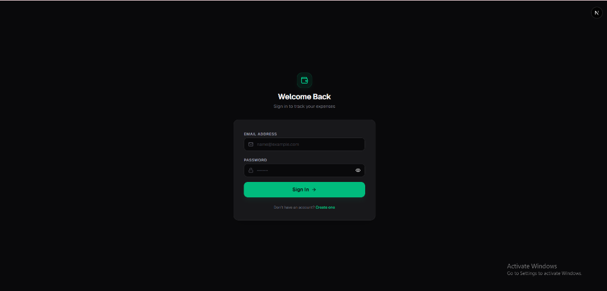
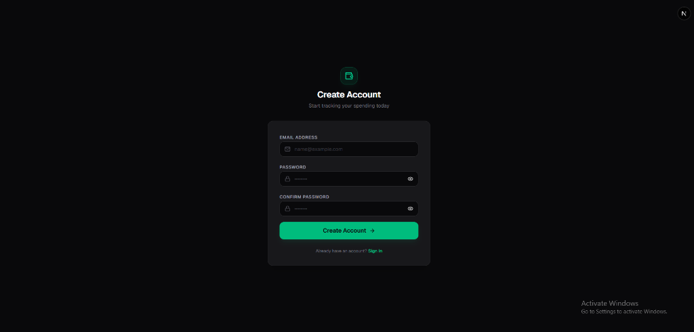
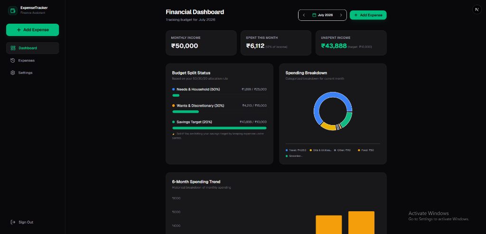
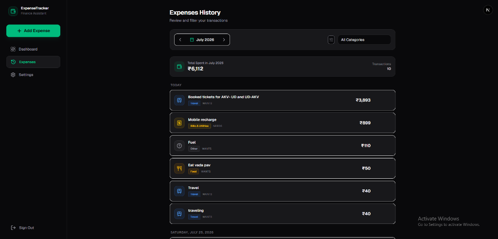
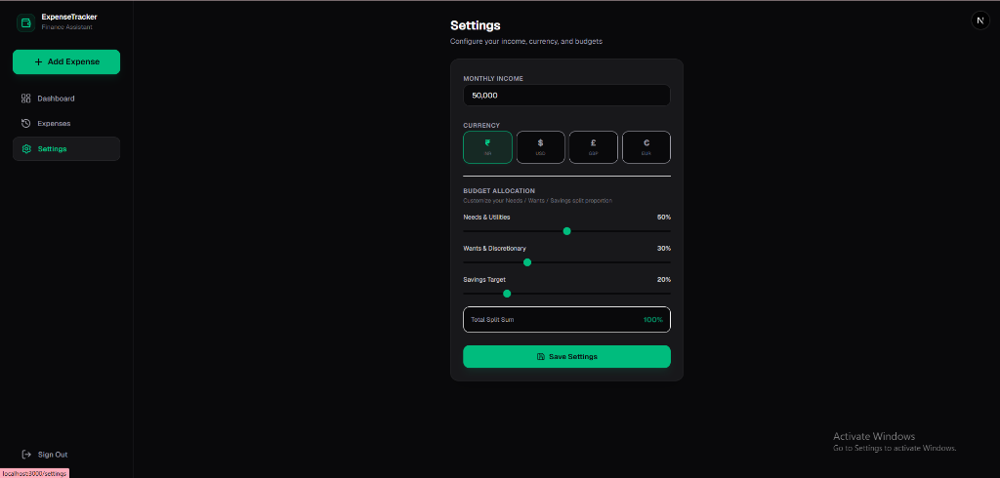

# 🌟 ExpenseTracker - Symmetrical, Mobile-First Finance Assistant

ExpenseTracker is a premium, personal finance web application built using **Next.js 14+ (App Router)** and **Supabase (Auth + PostgreSQL)**. It is designed to be mobile-first and fully installable as a progressive web app (PWA), providing a native-like experience on iOS and Android devices. It implements the popular **50/30/20 budget splitting rule** (Needs, Wants, and Savings) to give you strict, reactive guidance on your spending.

---

## 📸 App Screenshots

### 1. Welcome Back & Create Account (Authentication)
Features custom show/hide password toggle controls with touch-friendly icons.

<p align="center">
  
  &nbsp;&nbsp;&nbsp;&nbsp;
  
</p>

### 2. Symmetrical Financial Dashboard
Displays monthly income, dynamic spent ratios, and remaining unspent limits. Contains a categorised breakdown donut chart, a 6-month comparative trend stacked chart, and a mobile-friendly month navigation overlay.

<p align="center">
  
</p>

### 3. Expenses History Ledger
Tracks transaction totals, categories, date splits, description annotations, and lets you filter transactions dynamically.

<p align="center">
  
</p>

### 4. Configuration & Splits Settings
Enables users to customize monthly income, select preferred currency globally, and adjust budget allocation splits (Needs / Wants / Savings) with real-time constraint validation (splits must equal 100%).

<p align="center">
  
</p>

---

## ✨ Key Features

1. **Multi-User Isolation**: Enforced at the database level using PostgreSQL **Row Level Security (RLS)**. No user can view, update, insert, or delete another user's profile, categories, or expenses under any circumstances.
2. **Symmetrical Mobile Bottom Nav**: Balanced 5-column navigation layout tailored for phones, featuring Home, Expenses history, a floating central Add button, Settings, and a direct Sign Out tab.
3. **Interactive Dark Mode Calendar**: Custom z-indexed date picker overlay with navigation chevrons and a monthly day-grid. Built to replace the clunky browser default calendars, providing a consistent dark-theme UI.
4. **Interactive Year Grid**: Tapping the active year inside any month picker triggers a 12-year grid selection sheet (with decade chevrons shifting by 12-year chunks) to make multi-year back-jumps fast and touch-friendly.
5. **Real-time Comma Formatting**: Currency amounts and net income inputs are formatted with grouping separators in real-time as you type (e.g. `50,000` or `1,00,000`). Utilizes `inputMode="decimal"` to display the native numeric keypad on touchscreens.
6. **Budget Warning Guidance**: Dynamically warns you on the dashboard when category splits (Needs/Wants) exceed their configured safety limits.
7. **PWA Standalone Support**: Includes a progressive web app manifest file and Apple mobile web meta tags to enable full-screen layout on home screen installation.

---

## 🛠️ Technology Stack

* **Core**: Next.js 14+ (App Router), TypeScript, Tailwind CSS
* **Database & Auth**: Supabase (PostgreSQL with RLS)
* **State & Fetching**: TanStack Query (React Query)
* **Form & Validation**: React Hook Form, Zod
* **Charts**: Recharts
* **Icons & Dates**: Lucide React, Date-fns

---

## 🚀 Getting Started

### 1. Clone the Project & Install Dependencies
```bash
npm install
```

### 2. Configure Supabase Environment Variables
Create a `.env` or `.env.local` file in the root folder:
```env
NEXT_PUBLIC_SUPABASE_URL=https://your-project-id.supabase.co
NEXT_PUBLIC_SUPABASE_ANON_KEY=your-anon-key
```

### 3. Setup the Database Schema
1. Go to your **Supabase Dashboard** > **SQL Editor**.
2. Click **New query**.
3. Copy the entire contents of [supabase/migration.sql](supabase/migration.sql).
4. Paste it in the query window and click **Run**.
   * *This sets up the tables (`profiles`, `categories`, `expenses`), triggers to create profiles on signup, enables RLS, creates query policies, and seeds default categories.*

### 4. Run the App
```bash
npm run dev
```
Open [http://localhost:3000](http://localhost:3000) to view it.

---

## 🧪 Testing Security (RLS)
To verify that Row Level Security successfully isolates data between different user accounts, we have provided a validation script. You can run it via:
```bash
npx ts-node src/scratch/test-rls.ts
```
This script acts as two separate authenticated sessions (`User A` and `User B`) and asserts that User B receives a permission exception or an empty result set when attempting to query or modify User A's expenses.
